<picture>
  <source media="(prefers-color-scheme: dark)" srcset="./assets/hero-dark.svg">
  
</picture>

<picture>
  <source media="(prefers-color-scheme: dark)" srcset="./assets/how-dark.svg">
  
</picture>

<picture>
  <source media="(prefers-color-scheme: dark)" srcset="./assets/built-dark.svg">
  
</picture>

<picture>
  <source media="(prefers-color-scheme: dark)" srcset="./assets/fast-dark.svg">
  
</picture>

<picture>
  <source media="(prefers-color-scheme: dark)" srcset="./assets/outro-dark.svg">
  
</picture>

Most of my work is in private repositories; the graph below counts it. Open source: <a href="https://github.com/Ingeniiious/voidbunny-app">VoidBunny</a> and <a href="https://github.com/Ingeniiious/vibebase">Vibe Base</a>.
